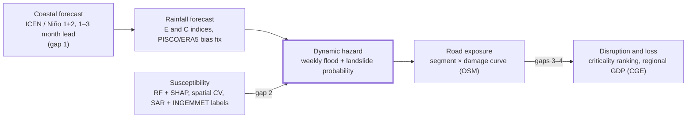

# PeruRoad Climate — Literature Review

Oct 17, 2026 · Paola Frisancho Mayorga

## Scope and method

Twenty papers survived verification, all in journals ranked Q1 or Q2 in SCImago (SJR) or Scopus CiteScore, and/or Clarivate JCR. Seven are Peru-specific, six cover northern Peru–Ecuador (far-eastern Pacific), one is Ecuador-only, and six are global methods transferable to Peru.

- **Search:** web search across publisher pages, institutional repositories (SENAMHI, IGP, CONCYTEC, PIK, IRD) and indexing services, October 2026. Each title, author list, year and DOI was checked against at least one bibliographic record.
- **Quartile check:** SCImago (SJR) was used where retrievable; otherwise Scopus CiteScore category ranks or JCR, as reported by secondary indexers (Peeref, ResearchJournalRank, Journal Metrics). The source used is named per paper. See the caveats section before citing quartiles formally.
- **Exclusions:** conference papers (IEEE, E3S, NeurIPS workshops), theses and grey literature, even when relevant (e.g., the INGEMMET national ANN landslide map and World Bank road criticality studies).
- **Metrics:** reported only when a source I opened states them. Where a paper's accuracy figures were not visible, the profile says so.

Each paper is tagged by what it actually models, because the three are routinely conflated:

| Layer | Question it answers | Typical output |
| --- | --- | --- |
| Hazard forecasting | Will the trigger happen, when, how strong? | Niño 1+2 SST anomaly, rainfall forecast, flood/landslide nowcast |
| Susceptibility | Where would damage occur if triggered? | Static flood/landslide susceptibility map (AUC-validated) |
| Exposure / impact | What infrastructure is in harm's way, and what does it cost? | Road km exposed, expected annual damage, GDP/poverty effects |

## Ranked comparison

The two most relevant papers are the only Q1/Q2 studies that tie El Niño directly to flood susceptibility in Piura (#1) and to road damage in Peru (#2); nothing in the verified set chains forecast → susceptibility → road exposure end to end. Rank reflects relevance to PeruRoad Climate, not quality.

| # | Paper | Journal, year | Quartile (source) | Region | Layer | Core method | Open data / code |
| --- | --- | --- | --- | --- | --- | --- | --- |
| 1 | [Badillo-Rivera et al. — Flood susceptibility in El Niño, Piura](https://doi.org/10.3389/fenvs.2025.1672107) | Front. Environ. Sci., 2025 | Q2 (JCR 2025, Environmental Sciences) | Piura basin, Peru | Susceptibility | Sentinel-1 NDFI flood mapping + SVM/RF, PCA, SHAP | Sentinel-1 (open); code not stated |
| 2 | [Montaud, Dávalos & Pécastaing — El Niño road damage risks](https://doi.org/10.1007/s10666-022-09830-9) | Environ. Model. Assess., 2022 | Q2 (SJR 2025, Environmental Science misc.) | Peru, national | Exposure / impact | VAR event model + bootstrap + dynamic multiregional CGE | Not stated |
| 3 | [Peng et al. — The 2023 extreme coastal El Niño](https://doi.org/10.1126/sciadv.adk8646) | Science Advances, 2024 | Q1 (SJR, not re-checked) | N. Peru–Ecuador coast | Hazard forecasting | Observations + ocean/atmosphere model experiments; NMME hindcasts | Open access |
| 4 | [Aybar et al. — PISCOp gridded rainfall for Peru](https://doi.org/10.1080/02626667.2019.1649411) | Hydrol. Sci. J., 2020 | Q1 (Scopus CiteScore, Water Sci. & Tech.); Q2 (JCR 2023) | Peru, national | Data | Geostatistical merging of gauges, radar climatologies, CHIRP | Yes — piscoprec.github.io |
| 5 | [Fernandez-Palomino et al. — RAIN4PE](https://doi.org/10.1175/JHM-D-20-0285.1) | J. Hydrometeorol., 2022 | Q1 (Scopus CiteScore, Atmos. Sci.); Q2 (JCR 2024) | Peru + Ecuador | Data | Random-forest merging (gauges, CHIRP, ERA5, DEM) + streamflow correction; SWAT at 72 sections | Yes — GFZ data DOI, GEE catalog |
| 6 | [Farias de Reyes et al. — Max daily rainfall, Piura, El Niño](https://doi.org/10.3390/w16233452) | Water, 2024 | Q1 (SJR 2025, Water Sci. & Tech.) | Piura basin, Peru | Hazard (extremes) | Station + PISCO extremes by hydrologic unit; 20 CMIP6 GCMs | PISCO (open) |
| 7 | [Peng et al. — Dynamics of the 2017 extreme coastal El Niño](https://doi.org/10.1038/s41467-018-08258-8) | Nat. Commun., 2019 | Q1 (SJR, not re-checked) | N. Peru–Ecuador | Hazard forecasting | Ocean/atmosphere GCM experiments; seasonal forecast check | Open access |
| 8 | [Rollenbeck et al. — 2017 coastal El Niño, weather radar](https://doi.org/10.3390/rs14040824) | Remote Sensing, 2022 | Q1 (SJR 2025, Earth & Planet. Sci. misc.) | S. Ecuador–N. Peru | Hazard (observation) | X-band radar QPE network, 2014–2018 | Open access paper |
| 9 | [Koks et al. — Global multi-hazard risk to road and rail](https://doi.org/10.1038/s41467-019-10442-3) | Nat. Commun., 2019 | Q1 (SJR, not re-checked) | Global | Exposure / impact | Asset-level intersection of OSM roads with hazard maps; damage curves; EAD; cost–benefit | OSM + global hazard maps (open) |
| 10 | [Badillo-Rivera et al. — Mass movements, Northern Lima](https://doi.org/10.3390/geosciences14060168) | Geosciences, 2024 | Q2 (SJR 2025, Earth & Planet. Sci. misc.) | Lima, Peru | Susceptibility + scenario hazard | WoE, LR, MLP, SVM, RF, NB; El Niño and Mw 8.8 scenarios | INGEMMET inventory (open) |
| 11 | [Kumar et al. — Ensemble ML landslide susceptibility, S. Peru](https://doi.org/10.3390/rs15051376) | Remote Sensing, 2023 | Q1 (SJR 2025, Earth & Planet. Sci. misc.) | Arequipa region, Peru | Susceptibility | Ensemble feature selection + ensemble ML, 24 factors | Open access paper |
| 12 | [Stanley et al. — LHASA v2 global landslide nowcasting](https://doi.org/10.3389/feart.2021.640043) | Front. Earth Sci., 2021 | Q2 (SJR 2025, Earth & Planet. Sci. misc.) | Global | Hazard nowcasting | Data-driven model on GPM rainfall, soil moisture, snow + static factors | Yes — NASA GES DISC product |
| 13 | [Nearing et al. — AI flood prediction in ungauged basins](https://doi.org/10.1038/s41586-024-07145-1) | Nature, 2024 | Q1 (SJR, not re-checked) | Global | Hazard forecasting | Hindcast + forecast LSTM, static basin attributes | Real-time public forecasts (80+ countries) |
| 14 | [Sulca et al. — ENSO flavors and Peru summer rainfall](https://doi.org/10.1002/joc.5185) | Int. J. Climatol., 2018 | Q1 best (SJR 2025, Statistics); Q2 Atmos. Sci. | Peru / S. America | Hazard (teleconnection) | Regression of E and C indices, SPCZ/ITCZ on PISCO, GPCP, CMAP | Public datasets |
| 15 | [Takahashi & Martínez — The very strong coastal El Niño in 1925](https://doi.org/10.1007/s00382-017-3702-1) | Climate Dynamics, 2019 | Q1 (Scopus CiteScore, Atmos. Sci.); Q2 (JCR 2024) | Far-eastern Pacific | Hazard (mechanism) | Historical instrumental + documentary reconstruction | Historical records |
| 16 | [Garreaud — Atmospheric trigger for the 2017 coastal El Niño](https://doi.org/10.1002/joc.5426) | Int. J. Climatol., 2018 | As #14 | Peru–Ecuador | Hazard (mechanism) | Reanalysis diagnostics (NCEP), OISST, OLR | Public datasets |
| 17 | [Brenning et al. — Landslides near highways, S. Ecuador](https://doi.org/10.5194/nhess-15-45-2015) | NHESS, 2015 | Q1 (JCR 2024; Scopus CiteScore) | Loja, Ecuador | Susceptibility × roads | GAM/GLM with spatial block bootstrap, 2,185 initiation points | Open access paper |
| 18 | [Zhou & Zhang — 3D-Geoformer ENSO transformer](https://doi.org/10.1126/sciadv.adf2827) | Science Advances, 2023 | Q1 (SJR, not re-checked) | Tropical Pacific | Hazard forecasting | Spatiotemporal self-attention on 3D ocean temperature + wind stress | Open access paper |
| 19 | [Ham, Kim & Luo — Deep learning for multi-year ENSO forecasts](https://doi.org/10.1038/s41586-019-1559-7) | Nature, 2019 | Q1 (SJR, not re-checked) | Tropical Pacific | Hazard forecasting | CNN with transfer learning (CMIP5 → reanalysis) | Paper; reanalysis inputs public |
| 20 | [Bentivoglio et al. — Hydraulics-based GNN flood modelling](https://doi.org/10.5194/hess-27-4227-2023) | HESS, 2023 | Q1 (JCR) | Synthetic dike-breach cases | Hazard (inundation surrogate) | SWE-inspired graph neural network | Open access paper |

## Profiles — Coastal El Niño and ENSO forecasting

Coastal El Niño is predictable only about one month ahead, while deep-learning models forecast basin-wide ENSO (Niño 3.4) up to 18 months ahead. That mismatch is the central forecasting problem for northern Peru.

### #3 Peng, Xie, Passalacqua, Miyamoto & Deser (2024) — The 2023 extreme coastal El Niño: atmospheric and air-sea coupling mechanisms

Science Advances 10(12): eadk8646 · [doi:10.1126/sciadv.adk8646](https://doi.org/10.1126/sciadv.adk8646)

- **Objective / area:** explain onset, growth and decay of the boreal-spring 2023 event off Peru and Ecuador.
- **Method:** observations, reanalysis, ocean-model and atmospheric-model experiments, heat-budget analysis; NMME rainfall forecasts initialized January–April 2023.
- **Findings:** northerly alongshore winds and eastern-Pacific westerlies, first linked to a record-strong MJO and a cyclonic disturbance off Peru in March, drove warming by suppressing upwelling and forcing downwelling Kelvin waves. Coastal warming fed back on the winds through deep convection; seasonal cooling in May broke the feedback. The event was predictable at a 1-month lead.
- **Limitations:** ocean and atmosphere simulated separately, not coupled; the Kelvin-wave contribution needs finer simulation (IGP's [technical reading](https://cienciaclimatica.igp.gob.pe/interpretaciones/94917074/descargar-docx)).
- **Relevance:** sets the realistic lead time for PeruRoad Climate alerts on the north coast — weeks, not seasons — and names the triggers to monitor (MJO phase, alongshore winds, coastal convection).

### #7 Peng, Xie, Wang, Zheng & Zhang (2019) — Coupled ocean–atmosphere dynamics of the 2017 extreme coastal El Niño

Nature Communications 10 · [doi:10.1038/s41467-018-08258-8](https://doi.org/10.1038/s41467-018-08258-8)

- **Objective / area:** mechanism of the February–April 2017 coastal warming, which occurred under weak La Niña conditions.
- **Method:** observations, ocean GCM and atmospheric GCM experiments, operational seasonal forecasts, CMIP projections.
- **Findings:** SST off Peru exceeded 28 °C in March 2017. Kelvin waves from westerly wind events plus northerly coastal winds caused the warming, and a local positive feedback amplified it. Seasonal models initialized on 1 February 2017 captured the extreme rainfall; projections suggest more frequent extreme coastal events under warming.
- **Limitations:** a single event; skill was shown qualitatively, not as a multi-event verification score.
- **Relevance:** physical basis for including coastal wind and local SST predictors, not just Niño 3.4, in any Peru rainfall forecast.

### #15 Takahashi & Martínez (2019) — The very strong coastal El Niño in 1925 in the far-eastern Pacific

Climate Dynamics 52: 7389–7415 · [doi:10.1007/s00382-017-3702-1](https://doi.org/10.1007/s00382-017-3702-1)

- **Objective / area:** reconstruct the 1925 event, the third strongest of the 20th century by its impacts in northern Peru and Ecuador.
- **Method:** historical ship, station and hydrological records plus newspaper archives.
- **Findings:** the far-eastern Pacific was warm while the central Pacific was cool. Onset came with an abrupt shift to northerly cross-equatorial winds and a southward ITCZ; Kelvin waves were not important for onset. The authors distinguish two families of very strong events: basin-wide (1982–83, 1997–98) and coastal (1925, later 2017 and 2023). IGP's reading notes Zorritos (Tumbes) logged 1,524 mm in 1925 against a 194 mm multi-year mean.
- **Limitations:** historical data accuracy is hard to verify; the MJO is not analyzed.
- **Relevance:** a historical analogue and an extreme scenario for stress-testing road exposure in Tumbes–Piura.

### #16 Garreaud (2018) — A plausible atmospheric trigger for the 2017 coastal El Niño

International Journal of Climatology 38(S1): e1296–e1302 · [doi:10.1002/joc.5426](https://doi.org/10.1002/joc.5426)

- **Objective / area:** identify the atmospheric trigger of 2017 off Peru and Ecuador.
- **Method:** reanalysis diagnostics (NCEP winds, geopotential), Reynolds daily and HadISST SST, NOAA OLR.
- **Findings:** the event was largely unpredicted even weeks before onset. A remotely forced weakening of free-tropospheric westerlies over the subtropical Andes relaxed the southeasterly trades, reducing upwelling and evaporative cooling.
- **Limitations:** a conceptual model; Kelvin waves are not examined.
- **Relevance:** points to upper-air predictors over the subtropical Andes as candidate early-warning features.

### #19 Ham, Kim & Luo (2019) — Deep learning for multi-year ENSO forecasts

Nature 573: 568–572 · [doi:10.1038/s41586-019-1559-7](https://doi.org/10.1038/s41586-019-1559-7)

- **Method:** a CNN trained first on CMIP5 historical runs, then on reanalysis 1871–1973 (transfer learning); validated 1984–2017.
- **Findings:** skilful Niño 3.4 forecasts up to about 18 months ahead; all-season correlation above state-of-the-art dynamical systems; heat maps show physically sensible precursors.
- **Limitations:** target is the central Pacific index, not Niño 1+2; the observational record is short.
- **Relevance:** the transfer-learning recipe (pretrain on climate-model runs, fine-tune on reanalysis) is the most transferable idea for the scarce coastal-event record.

### #18 Zhou & Zhang (2023) — A self-attention–based neural network for three-dimensional multivariate modeling and its skillful ENSO predictions

Science Advances 9(10): eadf2827 · [doi:10.1126/sciadv.adf2827](https://doi.org/10.1126/sciadv.adf2827)

- **Method:** 3D-Geoformer, a spatiotemporal transformer predicting 3D upper-ocean temperature anomalies and wind stress.
- **Findings:** high Niño 3.4 correlation skill at 18-month leads, including forecasts started in boreal spring; sensitivity tests reproduce the Bjerknes feedback. Follow-ups applied it to the 2021 second-year La Niña (GRL, 2023) and to real-time 2023–2024 predictions (Science China Earth Sciences, 2024).
- **Limitations:** basin-scale target; coastal Niño 1+2 dynamics not tested.
- **Relevance:** a candidate backbone for a Niño 1+2-targeted transformer, if retrained with coastal predictors.

## Profiles — Precipitation data and El Niño rainfall extremes

Peru has two strong gridded rainfall products (PISCOp, RAIN4PE), but neither is real-time and RAIN4PE ends before the 2017 and 2023 events. Which ENSO flavor occurs (eastern vs central Pacific) flips the rainfall sign across the Andes.

### #4 Aybar, Fernández, Huerta, Lavado, Vega & Felipe-Obando (2020) — Construction of a high-resolution gridded rainfall dataset for Peru from 1981 to the present day

Hydrological Sciences Journal 65(5): 770–785 · [doi:10.1080/02626667.2019.1649411](https://doi.org/10.1080/02626667.2019.1649411)

- **Objective / area:** national gridded rainfall (PISCOp v2.1) for hydrology and water management.
- **Method:** geostatistical and deterministic merging of three sources: quality-controlled, infilled SENAMHI gauges; radar–gauge climatologies; CHIRP satellite estimates.
- **Data / resolution:** 0.1°, 1981–present, about eight weeks' latency; public at [piscoprec.github.io](https://piscoprec.github.io/).
- **Limitations:** the latency rules it out for nowcasting; satellite-merged products smooth convective extremes.
- **Relevance:** the default historical rainfall layer and training target for Peru-wide heatmaps and susceptibility triggers.

### #5 Fernandez-Palomino, Hattermann, Krysanova, Lobanova, Vega-Jácome, Lavado, Santini, Aybar & Bronstert (2022) — A novel high-resolution gridded precipitation dataset for Peruvian and Ecuadorian watersheds (RAIN4PE)

Journal of Hydrometeorology · [doi:10.1175/JHM-D-20-0285.1](https://doi.org/10.1175/JHM-D-20-0285.1) · data [doi:10.5880/pik.2020.010](https://doi.org/10.5880/pik.2020.010)

- **Method:** random-forest merging of gauges, CHIRP, ERA5 and elevation, then a streamflow-based correction where rainfall was underestimated (páramos, montane basins).
- **Data / resolution:** daily, 0.1°, 1981–2015, Peru + Ecuador; mirrored in the [GEE community catalog](https://gee-community-catalog.org/projects/gridded_ppt/).
- **Findings / metrics:** SWAT calibrated and validated at 72 river sections. RAIN4PE gave better streamflow than CHIRP, ERA5, CHIRPS, MSWEP and PISCO; the gauge-corrected products struggled in several Pacific-draining and Amazon basins.
- **Limitations:** stops in 2015, so it excludes 2017 and 2023.
- **Relevance:** the best-documented input for hydrological modelling of Pacific-slope basins (Tumbes, Chira-Piura, Chancay-Lambayeque); needs extension past 2015.

### #6 Farias de Reyes, Chávarri-Velarde, Cotrina, Aguilar & Vegas (2024) — Space-time variability of maximum daily rainfall in Piura River Basin in Peru related to El Niño occurrence

Water 16(23): 3452 · [doi:10.3390/w16233452](https://doi.org/10.3390/w16233452)

- **Objective / area:** classify El Niño and La Niña events by intensity and origin, and map maximum daily rainfall by hydrologic unit in the Piura basin.
- **Method / data:** 1950–2023 records from 23 stations, PISCO, and ocean–atmosphere indices; future change from 20 CMIP6 GCMs.
- **Findings:** maximum daily rainfall rises during El Niño years, centered on the middle basin; the authors argue design rainfall for infrastructure must account for El Niño variability.
- **Limitations:** single basin; return-period statistics are stationary-by-regime rather than conditioned on a forecast.
- **Relevance:** directly supplies event-conditioned design storms for road drainage and bridge exposure in Piura.

### #8 Rollenbeck, Orellana-Alvear, Bendix, Rodriguez, Pucha-Cofrep, Guallpa, Fries & Célleri (2022) — The coastal El Niño event of 2017 in Ecuador and Peru: a weather radar analysis

Remote Sensing 14(4): 824 · [doi:10.3390/rs14040824](https://doi.org/10.3390/rs14040824)

- **Method / data:** a new X-band weather-radar network in southern Ecuador and northern Peru; 2017 compared against 2014–2018.
- **Findings:** isolated Niño 1+2 warming was the initial driver; topography reshaped local rainfall. 2017 brought positive anomalies on the coastal plain and on the eastern Andean slopes, which the authors attribute to a La Niña Modoki–type pattern.
- **Limitations:** short radar record and single-event focus; radar calibration uncertainty raised in review.
- **Relevance:** radar is the only sub-daily, high-resolution observation of these storms; useful for nowcast validation in Tumbes–Piura.

### #14 Sulca, Takahashi, Espinoza, Vuille & Lavado-Casimiro (2018) — Impacts of different ENSO flavors and tropical Pacific convection variability (ITCZ, SPCZ) on austral summer rainfall in South America, with a focus on Peru

International Journal of Climatology 38(1): 420–435 · [doi:10.1002/joc.5185](https://doi.org/10.1002/joc.5185)

- **Method / data:** linear regression of the E (eastern) and C (central Pacific) indices plus SPCZ and ITCZ indices on DJF rainfall, 1980–2016; PISCO (0.05°), GPCP and CMAP (2.5°), reanalysis.
- **Findings:** positive C dries the tropical Andes; per IGP's [reading](https://cienciaclimatica.igp.gob.pe/interpretaciones/1270116248/descargar-docx), eastern-Pacific warming (E) brings more rain to the north coast and western Andes of Tumbes, Piura, Lambayeque, La Libertad and Lima.
- **Limitations:** linear, seasonal-mean relationships; extremes not modelled.
- **Relevance:** forecast features must separate E and C; a single Niño 3.4 index mixes opposite rainfall responses.

## Profiles — Flood and landslide susceptibility and nowcasting

Peruvian susceptibility studies routinely report AUC above 0.9 with random forest, but they are static maps; the time-varying layer comes only from global systems (LHASA, Google's LSTM flood model) that have not been validated in Peru.

### #1 Badillo-Rivera, Santiago, Poma, Chavez, Arroyo-Paz, Aucahuasi-Almidon, Hinostroza, Segura, Eyzaguirre, León & Virú-Vásquez (2025) — Flood susceptibility mapping in El Niño phenomenon integrating multitemporal radar analysis, GIS and machine learning techniques, Piura River basin, Peru

Frontiers in Environmental Science 13 · [doi:10.3389/fenvs.2025.1672107](https://doi.org/10.3389/fenvs.2025.1672107)

- **Objective / area:** flood susceptibility in the Piura region, centered on the 2017 coastal El Niño.
- **Method:** Sentinel-1 SAR flood extent via the Normalized Difference Flood Index; ten topographic variables, NDVI, geology and geomorphology as predictors; six maps from SVM and random forest, with PCA and SHAP for interpretation.
- **Findings:** the lower Piura basin was most susceptible in 2017, driven by morphology and unplanned land occupation.
- **Metrics:** not captured from the pages I opened — check the full text before citing a number.
- **Limitations:** training labels come from one event; no rainfall forcing, so it cannot say when flooding occurs.
- **Relevance:** the closest existing template for PeruRoad Climate's flood layer — SAR-derived labels plus explainable ML in the priority region.

### #10 Badillo-Rivera, Olcese, Santiago, Poma, Muñoz, Rojas-León, Chávez, Eyzaguirre, Rodríguez & Oyanguren (2024) — A comparative study of susceptibility and hazard for mass movements applying quantitative machine learning techniques — Northern Lima Commonwealth, Peru

Geosciences 14(6): 168 · [doi:10.3390/geosciences14060168](https://doi.org/10.3390/geosciences14060168)

- **Method:** weights of evidence, logistic regression, MLP, SVM, random forest and naive Bayes, with correlation, multicollinearity and dimensionality-reduction checks; INGEMMET 1:50,000 inventory (2021).
- **Findings / metrics:** every model exceeded AUC 0.9, random forest best. Under an El Niño scenario about 40% of the area falls in the highest hazard levels; under a Mw > 8.8 earthquake, about 35%.
- **Limitations:** the authors state input-data availability limits results; the El Niño scenario is a static trigger, not a forecast.
- **Relevance:** shows how to turn a susceptibility map into scenario hazard — the step PeruRoad Climate needs before intersecting roads.

### #11 Kumar, Walton, Santi et al. (2023) — An ensemble approach of feature selection and machine learning models for regional landslide susceptibility mapping in the arid mountainous terrain of southern Peru

Remote Sensing 15(5): 1376 · [doi:10.3390/rs15051376](https://doi.org/10.3390/rs15051376)

- **Method / data:** historical inventory and 24 conditioning factors from remote sensing and auxiliary data; ensemble feature selection combined with ensemble ML.
- **Findings:** about 2–3% of the area is "very high" and 10–12% "high" susceptibility.
- **Limitations:** arid southern Andes, outside the El Niño rainfall core; no temporal trigger.
- **Relevance:** a reusable feature-selection protocol for the dozens of candidate conditioning factors a national model would face.

### #12 Stanley, Kirschbaum, Benz, Emberson, Amatya, Medwedeff & Clark (2021) — Data-driven landslide nowcasting at the global scale (LHASA v2)

Frontiers in Earth Science 9 · [doi:10.3389/feart.2021.640043](https://doi.org/10.3389/feart.2021.640043)

- **Method:** v1 used a decision tree on 7-day satellite rainfall plus a static susceptibility map (60°N–60°S, every 3 h). v2 replaces the map with explanatory variables and adds soil moisture and snow, trained on an expanded Global Landslide Catalog.
- **Findings / metrics:** at the same global false-positive rate, v2 was twice as likely as v1 to predict historical landslides over a 5-year retrospective run.
- **Limitations:** performance is tied to inventory coverage, which is thin in Peru; the authors flag data as the main global constraint.
- **Relevance:** an operational, open daily product (NASA GES DISC) to benchmark any Peru landslide nowcast against.

### #13 Nearing et al. (2024) — Global prediction of extreme floods in ungauged watersheds

Nature 627: 559–563 · [doi:10.1038/s41586-024-07145-1](https://doi.org/10.1038/s41586-024-07145-1)

- **Method:** hindcast and forecast LSTMs fed with public weather data and static basin attributes.
- **Findings / metrics:** in ungauged basins, reliability at a 5-day lead matched or beat same-day nowcasts from the Copernicus GloFAS system; accuracy on 5-year return events was similar to current accuracy on 1-year events. The model runs operationally in over 80 countries.
- **Limitations:** riverine floods only — not flash floods or debris flows; the authors call for more hydrological data.
- **Relevance:** strong evidence that an LSTM trained on many basins can serve Peru's sparsely gauged Pacific slope; a baseline to beat.

### #20 Bentivoglio, Isufi, Jonkman & Taormina (2023) — Rapid spatio-temporal flood modelling via hydraulics-based graph neural networks

Hydrology and Earth System Sciences 27: 4227–4246 · [doi:10.5194/hess-27-4227-2023](https://doi.org/10.5194/hess-27-4227-2023)

- **Method:** SWE–GNN, a graph neural network whose propagation rule follows the shallow water equations, trained on numerical dike-breach simulations.
- **Findings:** generalizes inundation dynamics to unseen topographies and breach locations at a fraction of solver cost.
- **Limitations:** synthetic flat terrain; untested on steep Andean channels or debris-laden flows.
- **Relevance:** the most credible GNN route to fast inundation surrogates for scenario runs in the Piura and Tumbes lowlands.

## Profiles — Road infrastructure exposure and impacts

Only one Q1/Q2 paper quantifies El Niño road damage in Peru, and it works at regional-economy scale, not road segments. Segment-level exposure methods exist globally (Koks et al.) but have not been applied to Peru with El Niño-conditioned hazard. For context, a World Bank [note](https://blogs.worldbank.org/en/latinamerica/recommendations-rural-roads-resilient-climate-change-peru) reports that the 2017 event affected about 60,000 km of roads, 37% of Peru's network (grey literature, not in the ranked set).

### #2 Montaud, Dávalos & Pécastaing (2022) — Socioeconomic risks of extreme El Niño event-related road damages in Peru

Environmental Modeling & Assessment 27(5): 831–851 · [doi:10.1007/s10666-022-09830-9](https://doi.org/10.1007/s10666-022-09830-9) · erratum p. 853 (affiliation and author contributions only)

- **Objective / area:** the macroeconomic risk to Peru from El Niño road damage.
- **Method:** event occurrence as a stochastic process (vector autoregression on historical climate data), simulated over 10 years by non-parametric bootstrap; impacts through a dynamic multiregional CGE model via higher interregional transport costs and an output externality estimated from firm data.
- **Findings / metrics:** a one-off risk of −2.8% GDP and +1.9% poverty rate, with annual probability 1.4%; over 10 years, average annual deviations of −0.8% GDP and +0.4% poverty with probability 12.6%. More disaster-resilient roads reduce these risks.
- **Limitations:** no road-segment geography or hazard maps; event occurrence is statistical, not forecast-driven.
- **Relevance:** the economic "so what" for PeruRoad Climate, and a source of region-level loss priors to calibrate segment-level damage.

### #9 Koks, Rozenberg, Zorn, Tariverdi, Vousdoukas, Fraser, Hall & Hallegatte (2019) — A global multi-hazard risk analysis of road and railway infrastructure assets

Nature Communications 10: 2677 · [doi:10.1038/s41467-019-10442-3](https://doi.org/10.1038/s41467-019-10442-3)

- **Method:** intersect about 50 million km of OpenStreetMap roads and rail with global hazard maps (reclassified into intensity bands), apply damage curves and reconstruction costs, compute expected annual damage (EAD) per segment, run cost–benefit on flood protection.
- **Findings / metrics:** about 27% of assets are exposed to at least one hazard and 7.5% to a 1-in-100-year flood. Global EAD is US$3.1–22 billion, about 73% from surface and river flooding; in some countries EAD reaches 0.5–1% of GDP. Flood protection pays off on about 60% of roads exposed to the 100-year flood.
- **Limitations:** coarse global hazard layers; no El Niño conditioning; debris flows are not a hazard class of their own.
- **Relevance:** the methodological template for PeruRoad Climate's exposure layer — swap global hazard maps for Peru-specific, El Niño-conditioned ones.

### #17 Brenning, Schwinn, Ruiz-Páez & Muenchow (2015) — Landslide susceptibility near highways is increased by 1 order of magnitude in the Andes of southern Ecuador, Loja province

Natural Hazards and Earth System Sciences 15: 45–57 · [doi:10.5194/nhess-15-45-2015](https://doi.org/10.5194/nhess-15-45-2015) · foundational, pre-2020

- **Method:** 2,185 mapped landslide initiation points in a 300 m corridor along two highways; GAM and GLM with topographic, climatic and geological confounders; spatial block bootstrap for confidence intervals.
- **Findings:** susceptibility within 25 m of a highway was about 20 times that at 200 m; the effect was stronger in Holocene gravels and Laramide andesite/basalt units.
- **Limitations:** one province; static analysis.
- **Relevance:** roads are both exposed and a cause. A "distance to road" predictor in a susceptibility model will inflate road exposure circularly unless handled explicitly.

## Critical review

Each layer has a mature method in isolation, but no verified study links an El Niño forecast to a Peru road segment. That missing chain is the defensible novelty for PeruRoad Climate.

### What works best, by layer

| Layer | Strongest evidence | Why it works | Main caveat |
| --- | --- | --- | --- |
| Basin-scale ENSO | CNN with transfer learning (#19); 3D-Geoformer transformer (#18) | Pretraining on climate-model runs overcomes the short observed record; skill to about 18 months for Niño 3.4 | Targets the central Pacific, which is not what floods Piura |
| Coastal El Niño | Coupled diagnosis + dynamical seasonal forecasts (#3, #7) | Coastal Bjerknes feedback gives about 1 month of predictability | One-month lead; rare events, so no skill statistics |
| Rainfall fields | Random-forest merging with streamflow correction (#5); geostatistical merging (#4) | Combines gauges, satellite and terrain; best streamflow in Pacific basins | Latency (PISCOp) or end date 2015 (RAIN4PE) |
| Riverine floods | Multi-basin LSTM (#13) | Learns across basins, works ungauged, 5-day lead | Not for flash floods or huaicos |
| Flood / landslide susceptibility | Random forest and ensembles, SHAP (#1, #10, #11) | AUC above 0.9 in Peruvian case studies | Static; single-event labels |
| Landslide nowcasting | LHASA v2 (#12) | Dynamic rainfall + soil moisture, daily, open | Thin Peru inventory in training |
| Road exposure | Asset-level OSM intersection + damage curves + EAD (#9); CGE for macro loss (#2) | Segment-level cost, cost–benefit ready | Global hazard maps, no El Niño conditioning |

### Limitations across the literature

- **Lead-time mismatch.** Deep-learning ENSO skill is for Niño 3.4 at 12–18 months; northern Peru's damaging rain comes from coastal warming predictable about one month ahead (#3, #7), and from the eastern-Pacific flavor rather than the central one (#14).
- **Few events, imbalanced classes.** Very strong far-eastern Pacific events in the record number about six: 1891, 1925, 2017 and 2023 (coastal) plus 1983 and 1998 (basin-wide). Any data-driven coastal model is trained on a handful of positives, which argues for transfer learning (#19) and physics-guided features.
- **Data latency.** PISCOp lags by about eight weeks; RAIN4PE stops in 2015. Real-time work must rely on GPM IMERG, CHIRPS or ERA5 and correct their known Pacific-slope biases (#5).
- **Optimistic susceptibility scores.** High AUCs come from random point splits; Brenning et al. (#17) show the spatial block bootstrap that avoids leakage from spatial autocorrelation, and few Peruvian studies use it.
- **Debris flows (huaicos) are under-modelled.** No Q1/Q2 Peru study in this set forecasts huaico activation from rainfall; INGEMMET and IGP monitoring exists mostly as technical reports.
- **Road endogeneity.** Roads raise landslide occurrence nearby (#17). Using distance-to-road as a predictor and then measuring road exposure double-counts.
- **Exposure without damage functions.** Koks et al. (#9) rely on generic curves; none in the set calibrates damage for unpaved Andean or coastal-desert roads.

### Research gaps that justify a novel contribution

1. **A Niño 1+2 / ICEN-targeted forecaster.** No Q1/Q2 deep-learning model in the set targets the coastal index with coastal predictors (alongshore winds, MJO phase, subtropical Andes westerlies, Kelvin-wave proxies).
2. **Forecast-conditioned susceptibility.** Peruvian flood and landslide maps are static; none converts a rainfall forecast into a time-varying hazard probability per basin or slope unit.
3. **Segment-level road exposure under El Niño scenarios.** Montaud et al. (#2) give national economics and Koks et al. (#9) give a global segment method; no study joins them for Peru with 2017 and 2023 as validation events.
4. **Network criticality.** None of the verified papers measures which segments, when cut, isolate the most people or freight in northern Peru; a graph model of the road network is absent.
5. **Uncertainty carried through the chain.** Each paper reports its own layer's skill; no study propagates forecast uncertainty into exposure estimates.

## Recommendations and proposed research direction

The most feasible novel study is a forecast-conditioned road disruption model for Tumbes, Piura and Lambayeque at a 1–4 week lead, validated by hindcasting 2017 and 2023.

### Recommended datasets

| Dataset | Provider | Role in PeruRoad Climate | Note |
| --- | --- | --- | --- |
| PISCOp v2.1 | SENAMHI (#4) | Historical rainfall, heatmaps, training target | 0.1°, 1981–present, ~8-week lag |
| RAIN4PE | PIK / SENAMHI (#5) | Hydrological model forcing and calibration | 0.1° daily, 1981–2015 |
| ERA5, CHIRPS, GPM IMERG | ECMWF, UCSB-CHG, NASA | Near-real-time forcing and predictors | Bias-correct against PISCO on the Pacific slope (#5) |
| ICEN and Niño 1+2 SST | ENFEN, NOAA | Coastal forecast target | ICEN is ENFEN's official coastal index |
| NMME seasonal forecasts | NOAA | Dynamical baseline to beat | Captured 2017 and 2023 at short leads (#3, #7) |
| Sentinel-1 SAR | ESA Copernicus | Flood-extent labels for 2017 and 2023 | NDFI method in #1 |
| GEOCATMIN mass-movement inventory | INGEMMET | Landslide and debris-flow labels | Used in #10 |
| LHASA v2 nowcast; Global Landslide Catalog | NASA (#12) | Benchmark for landslide nowcasts | Daily, open |
| OpenStreetMap roads | OSM (#9) | Segment geometry for exposure | Cross-check with MTC network layers if obtainable |
| CMIP6 | WCRP (#6) | Pretraining (#19 recipe) and future scenarios | 20-GCM ensemble used in #6 |

### Recommended models and techniques

- **Coastal forecast:** a spatiotemporal transformer or ConvLSTM in the 3D-Geoformer mould (#18), pretrained on CMIP6 runs and fine-tuned on reanalysis (#19), targeting ICEN / Niño 1+2 at 1–3 month leads. Add predictors from #3, #7 and #16: MJO phase, alongshore winds, subtropical Andes westerlies. Baselines: persistence and NMME.
- **Rainfall:** condition forecasts on separate E and C indices (#14); evaluate heatmaps against PISCO extremes per hydrologic unit (#6).
- **Floods:** a multi-basin LSTM for Pacific-slope rivers (#13) forced by RAIN4PE/PISCO; SAR-labelled random forest or gradient boosting for susceptibility, explained with SHAP (#1); a GNN surrogate (#20) only for lowland inundation scenarios.
- **Landslides and huaicos:** slope-unit random forest validated with spatial block cross-validation (#17), plus a dynamic antecedent-rainfall layer in the style of LHASA v2 (#12).
- **Exposure:** Koks-style intersection of road segments with hazard probability and damage curves (#9); network criticality from graph metrics on the road network; Montaud et al. (#2) to translate disruption into regional economic loss.
- **Evaluation:** hold out 2017 and 2023 entirely; report Brier and reliability for forecasts, AUC under spatial CV for susceptibility, and hit rate on reported road cuts for exposure.

### Proposed research direction

Working title: *Forecast-conditioned road disruption risk in northern Peru under coastal El Niño.*

*Validate end to end on 2017 and 2023 hindcasts (gap 5).*

Each box exists in the literature on its own; the highlighted coupling of forecast rainfall with susceptibility is what no verified study does for Peru.

1. **Data cube** (months 1–3): harmonize PISCO, RAIN4PE, ERA5, Sentinel-1 flood extents, INGEMMET inventory and OSM roads on a common grid and slope-unit / segment index.
2. **Coastal forecast** (months 3–8): train the Niño 1+2 / ICEN model; gap 1.
3. **Dynamic hazard** (months 6–12): combine forecast rainfall with static susceptibility into weekly flood and landslide probabilities per basin and slope unit; gap 2.
4. **Exposure and criticality** (months 10–14): probability × segment × damage curve → expected disruption; rank critical segments by connectivity loss; gaps 3–4.
5. **Validation** (months 12–16): hindcast 2017 and 2023 and compare predicted cuts with reported damage; propagate uncertainty end to end; gap 5.

The 3D platform then visualizes outputs that already carry a verified skill score, which is what distinguishes it from a map viewer.

## Caveats and sources

Re-check quartiles in SCImago or JCR for the publication year you cite; most here come from secondary indexers and the latest available year.

- **Quartiles.** Only Environmental Modeling & Assessment was read directly on [SCImago](https://www.scimagojr.com/journalsearch.php?q=23276&tip=sid&clean=0) (Q2 every year 2009–2025). Others come from [ResearchJournalRank](https://researchjournalrank.com/journal/remote-sensing) (SJR 2025), [Peeref](https://peeref.com/journals/1769) (Scopus CiteScore rank + JCR) and [Journal Metrics](https://www.journalmetrics.org/journal/natural-hazards-and-earth-system-sciences) (JCR). Nature, Nature Communications and Science Advances were not re-checked. Quartiles differ by category: Int. J. Climatology is Q1 in Statistics but Q2 in Atmospheric Science (SJR 2025).
- **Limitations** in each profile are my assessment unless attributed to the authors or to IGP's [Ciencia Climática](https://cienciaclimatica.igp.gob.pe/) readings.
- **Missing metrics.** AUC or accuracy for #1 and #11 were not visible in the pages opened; read the full texts before quoting numbers.
- **Worth reading but not ranked:** Peng et al. (2025, Nature Geoscience) on the ocean-driven 2023–24 El Niño ([doi](https://doi.org/10.1038/s41561-025-01700-9)); Kim et al. (2022, Scientific Reports) STANet ENSO model ([doi](https://doi.org/10.1038/s41598-022-10839-z)), quartile not verified; the WSP/UNI/INGEMMET national ANN landslide map presented at the IIMP World Mining Congress ([proceedings](https://iimp.org.pe/WMC/actas/Track-1-AI-and-Data-Driven-Decision-Making/421/)); the World Bank road criticality study for Colombia, Ecuador and Peru ([PDF](https://thedocs.worldbank.org/en/doc/780311492653985192-0190022017/original/P147268LCRRegionalStudywithannexes.pdf)).

Sources opened beyond the DOIs above: [PISCO repository record](https://repositorio.senamhi.gob.pe/handle/20.500.12542/288?show=full) · [RAIN4PE catalog](https://gee-community-catalog.org/projects/gridded_ppt/) · [Montaud et al. record and erratum](https://faculty.up.edu.pe/en/publications/socioeconomic-risks-of-extreme-el-ni%C3%B1o-event-related-road-damages/) · [Takahashi & Martínez, IGP record](https://repositorio.igp.gob.pe/items/6685958a-1b90-48ed-8396-94e32b785b50/full) · [Garreaud, U. Chile record](https://repositorio.uchile.cl/handle/2250/152026?show=full) · [Peng et al. 2024, PMC](https://pmc.ncbi.nlm.nih.gov/articles/PMC10959421/) · [LHASA v2, NTRS](https://ntrs.nasa.gov/citations/20210015014) · [Koks et al., Oxford ORA](https://ora.ox.ac.uk/objects/uuid:b57644c9-535e-466d-bc13-0e459967c9fd) · [Nearing et al., Google Research](https://research.google/pubs/ai-increases-global-access-to-reliable-flood-forecasts/) · [Water 2024 Piura paper](https://www.mdpi.com/2073-4441/16/23/3452/xml)
